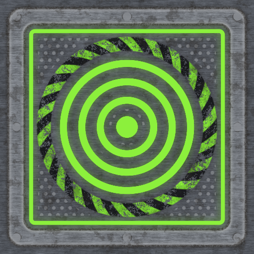
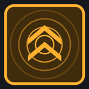
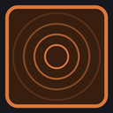
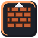

# Levitate!

**Hovercraft capture-the-flag in walled mazes**, a love letter to the
mid-1990s desktop maze racers. Glide through the maze, bounce off its walls,
ride springs up onto ledges and take every rival flag before the clock runs
out.

Levitate! is a first-party game built on the **[Fio](https://github.com/ViciousSquid/Fio)
3.5.1.0** engine, in the same way as [MiniWind](https://github.com/ViciousSquid/MiniWind).
Fio is the engine powering a total conversion here: Levitate! is built in and
always on, not an optional plugin. The editor that builds the mazes is one
click away in the launcher.

> **Status: block-out.** The three mazes are playable block-outs with the
> full rule set for a solo time trial. Rival hovercraft (bots), the
> barrier/jammer effects on rivals, and sound are next.

## Play it

```bash
python -m venv venv
source venv/bin/activate          # venv\Scripts\activate on Windows
pip install -r requirements.txt
python main.py
```

The launcher offers **PLAY**, **EDIT** or **Quit**:

* **PLAY** starts the chosen maze in Fio's kiosk mode, on its own native
  window (`[Kiosk] native_surface = True`), fullscreen, borderless or
  windowed as the Mode setting says. The editor is built hidden and stays
  dormant.
* **EDIT** opens the full Fio editor. Levitate!'s entities are under
  **Levitate!** in the entity menus.

Display mode, resolution, vsync, high-DPI, **HUD size** (Compact, the default, or
the original full-width Large; also in the pause menu) and the last maze are written back to
`settings.ini`, the same keys the editor's Settings window uses.

### Controls

| Key | Action | Key | Action |
|-----|--------|-----|--------|
| **W / S** | Thrust / reverse | **← / →** | Turn the craft |
| **A / D** | Side thrusters | **Mouse** | Look and steer |
| **1 / 2 / 3** | Fire the system in that slot | **R** | Retry once the round is over |
| **Esc** | Pause menu (Quit goes to the desktop) | **F12** | Leave fullscreen for the editor (`[Startup] allow_editor`) |

## The rules

Each maze has three **red** (home) and three **blue** (rival) flags. Glide
over a rival flag to take it; take all three before the clock runs out.

| Pad | | Power-up orb | |
|---|---|---|---|
|  Spring | Launches the craft up, onto ledges |  Shield | 12 s of protection |
|  Boost | A burst of speed along your heading |  Phantom | 10 s unseen by rivals |
|  Barrier | Loads a barrier into a free slot |  Barrier ·  Jammer | Act on rival craft (with the bots) |

Orbs fill the dashboard's three **system** slots; use them with **1–3**.

## The mazes

| | Size | Theme | Clock |
|---|---|---|---|
| **Breakwater** | 8 × 8 | Slate | 4:00 |
| **Sandglass** | 10 × 10 | Sand | 5:00 |
| **Mossgarden** | 11 × 9 | Moss | 5:30 |

All three are original layouts generated by `game/tools/make_mazes.py` from
fixed seeds. The script carves a maze, opens loops and plazas for racing, then
places flags, pads, ledges, orbs and lights. `GEOMETRY_SCALE` (1.5) sizes the
geometry (corridors, walls, floor, ledges) without changing pads, orbs, flags
or lights. Tune it or `MAZES` in that file and run:

```bash
python -m game.tools.make_mazes       # -> maps/levitate/*.json
```

Each maze is an ordinary Fio map, so you can open it in EDIT and keep
building by hand. The match needs one **Maze Rules** entity (`levitaterules`)
holding the title, clock and handling (friction, acceleration, turn rate,
wall bounce).

## Art

Everything Levitate! draws is original and generated in code by
`game/tools/make_art.py`. It covers the cockpit dashboard (speedometer, flag
tallies, CRT radar, system slots, LED clock, shield bar), icons, flag and orb
sprites, wall, floor and pad textures, the app icon, the splash and the
launcher banner.

```bash
python -m game.tools.make_art
```

## Layout

| Path | |
|---|---|
| `game/` | The game layer: `install()`, the launcher, the match host, hover handling, HUD |
| `game/ui/launcher.py` | MiniWind's launcher, rebranded, with a maze picker |
| `game/host.py` | Rules, flags, pads, orbs and the HUD hook (a Fio *built-in game*) |
| `game/hover.py` | Glide, steering and wall bounce on top of Fio's player physics |
| `game/ui/hud.py`, `hud_layout.py` | The cockpit HUD, painted through `render.overlay` |
| `maps/levitate/` | The mazes |
| `main.py` | Fio's bootstrap plus the game-module seam (`[Startup]`), ported from MiniWind |

### Engine changes on top of Fio 3.5.1.0

* `main.py`: `[Startup] game_module / show_launcher / default_map`, mandatory
  plugins, and a launch straight into kiosk mode with the editor built
  dormant. Ported from MiniWind and adapted to 3.5.1.0's settings file and
  loading bar.
* `editor/main_window.py`: `MainWindow(dormant=)`, `begin_dormant_launch`,
  `wake_editor`, `_hide_editor_chrome`. In a game launch, Quit from the pause
  menu goes to the desktop, and `[Startup] allow_editor` controls whether F12
  can reach the editor (`engine/qt_game_view.py`).

## Tests

```bash
QT_QPA_PLATFORM=offscreen python -m pytest game/tests -q
```

The tests cover every maze loading and playing on the real engine, the craft
gliding and bouncing off walls, flags being taken and winning, springs and
orbs, and the launcher's maze list. Fio's own suite still runs; see
[docs/FIO_README.md](docs/FIO_README.md) for the engine.
