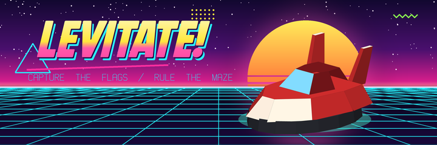

# Levitate!

**Hovercraft capture-the-flag in walled mazes**, a love letter to the
mid-1990s desktop maze racers. Glide through the maze, bounce off its walls,
ride springs up onto ledges and take every rival flag before the clock runs
out.

Levitate! is a first-party game built on the **[Fio](https://github.com/ViciousSquid/Fio)
3.5.1.0** engine, in the same way as [MiniWind](https://github.com/ViciousSquid/MiniWind).
Fio is the engine powering a total conversion here: Levitate! is built in and
always on, not an optional plugin. The editor that builds the mazes is one
click away in the launcher.

> **Status.** Five worlds, random mazes and the full rule set for a solo
> time trial, drawn with a sun, a sky, shadows and photo-scanned materials.
> Sound and rival hovercraft (bots) are next.

## Play it

```bash
python -m venv venv
source venv/bin/activate          # venv\Scripts\activate on Windows
pip install -r requirements.txt
python main.py
```

The launcher offers **PLAY**, **EDIT** or **Quit**:

* **PLAY** starts the chosen maze in Fio's kiosk mode, on its own native
  window (`[Kiosk] native_surface = True`), fullscreen, borderless or
  windowed as the Mode setting says. The editor is built hidden and stays
  dormant.
* **EDIT** opens the full Fio editor. Levitate!'s entities are under
  **Levitate!** in the entity menus.

The launcher also chooses the **maze** (any of the five worlds, or **Random
maze**: a new one every time), the **graphics** quality (below) and the **HUD
size** (Compact, the default, or the original full-width Large; also in the
pause menu). Everything is written back to `settings.ini`, the same keys the
editor's Settings window uses.

### Controls

| Key | Action | Key | Action |
|-----|--------|-----|--------|
| **W / S** | Thrust / reverse | **← / →** | Turn the craft |
| **A / D** | Side thrusters | **Mouse** | Look and steer |
| **1 / 2 / 3** | Fire the system in that slot | **R** | Retry once the round is over |
| **Esc** | Pause menu (Quit goes to the desktop) | **F12** | Leave fullscreen for the editor (`[Startup] allow_editor`) |

## The rules

Each maze has three **red** (home) and three **blue** (rival) flags. Glide
over a rival flag to take it; take all three before the clock runs out.

| Pad | | Power cell | |
|---|---|---|---|
|  Spring | Launches the craft up, onto ledges |  Shield | 12 s of protection |
|  Boost | A burst of speed along your heading |  Phantom | 10 s unseen by rivals |
|  Barrier | Loads a barrier into a free slot |  Barrier ·  Jammer | Act on rival craft (with the bots) |

Cells fill the dashboard's three **system** slots; use them with **1–3**.

## The worlds

Each maze is a world of its own: its own walls and floor, its own sky and
light, and its own skyline rising beyond the walls.

| | Size | World | Clock |
|---|---|---|---|
| **Breakwater** | 8 × 8 | A harbour wall: board-formed concrete on cracked asphalt, a bright blustery afternoon, a lighthouse over the wall | 4:00 |
| **Sandglass** | 10 × 10 | Desert ruins: sandstone blocks on gravelly sand, a low golden sun, obelisks and stepped temples | 5:00 |
| **Mossgarden** | 11 × 9 | An old walled garden: mossy brick on moss-jointed cobbles, a fresh morning under broken cloud | 5:30 |
| **Frostline** | 12 × 10 | High country: dry-stone walls in deep snow, a clear winter sun, crags all round | 6:00 |
| **Emberworks** | 12 × 11 | A foundry at night: rusted iron over tread plate, lamps on the piers throwing shadows, moonlight | 6:30 |

All five are original layouts generated by `game/tools/make_mazes.py` from
fixed seeds. The script carves a maze, opens loops and plazas for racing,
places flags, pads, ledges and power cells, then builds the world round it:
piers where walls meet, coping along their tops, a glow at every pad, cell and
flag, lamps where the world is dark, and scenery outside. Every face is mapped
at its material's real size. Tune `MAZES` and `WORLDS` in that file and run:

```bash
python -m game.tools.make_mazes       # -> maps/levitate/*.json
```

Each maze is an ordinary Fio map, so you can open it in EDIT and keep
building by hand. The match needs one **Maze Rules** entity (`levitaterules`)
holding the title, clock, world (`theme`) and handling (friction,
acceleration, turn rate, wall bounce).

### Random mazes

`game/random_maze.py` makes a maze nobody has played: any world, any size
from 5 × 5 to 16 × 16, as open as you like, from a seed.

* **Launcher ▸ Maze ▸ Random maze** builds a new one each time PLAY is pressed.
* **EDIT ▸ Tools ▸ Random Maze Generator…** is Fio's random level generator,
  now making Levitate! mazes: choose the world, size, openness, plazas, ledges,
  clock and seed, and Generate. A LevelChanger with *Generate level* on sends
  the player to a fresh maze the same way.
* `python tools/procedural_map_gen.py out.json --world frost --cols 10 --rows 8`

## Graphics

A match is drawn with Fio's **environment** renderer (added for Levitate!,
off everywhere else, so the editor and Fio's stock look are unchanged):

* a **sun** with a filtered shadow map, moving **cloud shadows**, and
  point-light shadows from lamps;
* a **sky** computed each frame (an analytic atmosphere under drifting cloud),
  which also lights the scene and is what smooth surfaces reflect;
* **physically based surfaces**: GGX specular, normal maps, parallax occlusion
  mapping, roughness / metalness / ambient-occlusion maps, emissive pads;
* an **HDR finish**: ambient occlusion, screen-space reflections, bloom, light
  shafts, ACES tone mapping, grading and FXAA.

`[Renderer] graphics` in `settings.ini` (the launcher's **Graphics**) sets how
much of that runs: `ultra`, `high` (default), `medium`, `low`, or `classic` --
Fio's plain renderer with the mazes' fill lights, for machines that cannot
afford the rest. Each world's look is a few lines in `game/graphics.py`.

## Art and materials

The **walls, floors, coping and metal** are photo-scanned PBR materials from
[Poly Haven](https://polyhaven.com) (CC0), fetched by
`game/tools/fetch_textures.py` and credited in
[`assets/textures/levitate/CREDITS.md`](assets/textures/levitate/CREDITS.md).

Everything else Levitate! draws is original and generated in code:

| | |
|---|---|
| `game/tools/make_art.py` | The logo (the hovercraft), app icon, splash and launcher banner, the cockpit dashboard, icons, hovercraft sprites |
| `game/tools/make_models.py` | The flags (pole, base, rippling cloth) and the power cells, as OBJ models with their maps |
| `game/tools/make_pads.py` | The pad plates: base colour, normal, roughness, and an emblem that glows |

```bash
python -m game.tools.make_art
python -m game.tools.make_models
python -m game.tools.make_pads
python -m game.tools.fetch_textures     # needs the network; the files are committed
```

The launcher is 1990s synthwave on blacklight bowling-alley carpet.

## Layout

| Path | |
|---|---|
| `game/` | The game layer: `install()`, the launcher, the match host, hover handling, HUD |
| `game/ui/launcher.py` | MiniWind's launcher, rebranded, with a maze picker |
| `game/host.py` | Rules, flags, pads, cells, the match's lighting and the HUD hook (a Fio *built-in game*) |
| `game/graphics.py` | The look of each world and the graphics qualities |
| `game/random_maze.py` | Random mazes: settings, the maze, the launcher's entry |
| `game/hover.py` | Glide, steering and wall bounce on top of Fio's player physics |
| `game/ui/hud.py`, `hud_layout.py` | The cockpit HUD, painted through `render.overlay` |
| `maps/levitate/` | The mazes |
| `main.py` | Fio's bootstrap plus the game-module seam (`[Startup]`), ported from MiniWind |

### Engine changes on top of Fio 3.5.1.0

* `main.py`: `[Startup] game_module / show_launcher / default_map`, mandatory
  plugins, and a launch straight into kiosk mode with the editor built
  dormant. Ported from MiniWind and adapted to 3.5.1.0's settings file and
  loading bar.
* `engine/renderer/forward/environment.py`, `surface.py`, `postfx.py`: the
  environment renderer described under *Graphics*. It is opt-in
  (`renderer.environment.enabled`), adds the physically based path to the lit
  shaders by rewriting them at compile time, and leaves `engine/shaders.py`
  as it was but for one fix. A texture gains companion maps by having
  `<name>_n`, `<name>_h`, `<name>_m` files beside it; OBJ materials may carry
  `Ke`, `Pr` and `Pm`.
* `editor/procedural_generator.py`: the random level generator makes
  Levitate! mazes.
* Fio's stock content (sample maps, sounds, models, monster and weapon
  sprites, textures) is not shipped; the tests of Fio's own suite that need
  it are skipped (`tests/stock_content.txt`).
* `editor/main_window.py`: `MainWindow(dormant=)`, `begin_dormant_launch`,
  `wake_editor`, `_hide_editor_chrome`. In a game launch, Quit from the pause
  menu goes to the desktop, and `[Startup] allow_editor` controls whether F12
  can reach the editor (`engine/qt_game_view.py`).

## Tests

```bash
xvfb-run -a python -m pytest game/tests -q      # or on any machine with a display
```

The tests cover every maze loading and playing on the real engine, the craft
gliding and bouncing off walls, flags being taken and winning, springs and
cells, each world's look and materials, the match switching the lighting on
and off, random mazes in every world and size, the repurposed generator, and
the launcher. Fio's own suite still runs; see
[docs/FIO_README.md](docs/FIO_README.md) for the engine.
